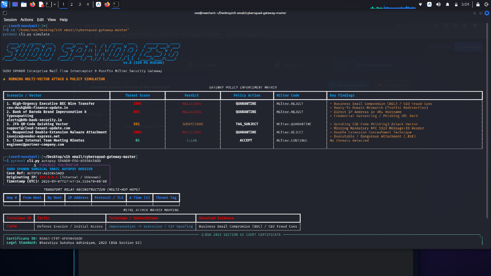

# 🛡️ SUDO SPANDR TUI
### ⚡ 100% Offline Air-Gap Email Forensic Terminal Workstation
**AICTE Smart India Hackathon 2026 | Problem Statement #26106**

<div align="center">

[](https://www.kali.org/)
[]()
[](https://sih.gov.in)
[]()

</div>

---

## 🚀 Live Terminal Demo

<div align="center">
  
</div>

---

## 💡 What is SUDO SPANDR? (In 10 Seconds)

Tired of uploading confidential case evidence to online cloud analyzers? 

**SUDO SPANDR TUI** is a lightweight, super-fast terminal tool that dissects raw `.eml` and `.msg` emails **100% offline** in under **50ms**. No cloud, no data leaks, pure forensic reverse-engineering.

### 🌟 4 Key Superpowers:
1. 🕵️ **Instant Spoof Detection**: Catches fake senders by matching Display `From` vs Envelope `Return-Path`.
2. 🔬 **True Magic Byte Carver**: Unmasks malware disguised as `.pdf.exe` using raw binary magic (`4D 5A`).
3. 📊 **Shannon Entropy Meter**: Spots packed shellcode & encrypted droppers in real-time ($0.00$ to $8.00$ bits).
4. ⚖️ **Section 63 BSA 2023 Certificate**: 1-Click court-admissible PDF certificate for Indian Police & Courts.

---

## ⚡ Quick Start (3 Commands)

```bash
# 1. Clone repo
git clone https://github.com/sudonishant/SUDO-SPANDR-TUI.git
cd SUDO-SPANDR-TUI

# 2. Install dependencies
pip install -r requirements.txt

# 3. Launch TUI Workstation
./run_tui.sh
```
*(Or launch the NSA Ghidra-style GUI: `./run_gui.sh`)*

---

## 📸 Visual Tour (Tabs at a Glance)

| Tab | Preview | What it does |
|:---:|:---:|:---|
| **[1] Command Deck** |  | **Master Dashboard**: File picker, sender spoof check, hop route & live entropy meter. |
| **[2] Hop Map** |  | **Network Transit**: Full RFC 5322 header disassembly & transit latency timeline. |
| **[3] CatBERT AI** |  | **Cognitive NLP**: Detects urgency triggers, psychological coercion & fake bank lures. |
| **[4] Hex Carver** |  | **Byte View**: 16-byte Ghidra/IDA hex dump with live Shannon entropy speedometer. |
| **ESG Gateway** |  | **Enterprise Simulator**: Live BEC, Quishing & Trojan multi-vector simulation. |

---

## ⌨️ Cheat Sheet (Keyboard Shortcuts)

Just press a single key to navigate — no complex menus!

| Key | What it does |
|:---:|:---|
| **`[SPACE]`** | **⚡ 1-Click Auto-Audit** (Runs entire autopsy in 1 second) |
| **`[1]` – `[8]`** | Direct tab switching |
| **`[↑]` / `[↓]`** | Select email from seized folder |
| **`[Enter]`** | Load selected email |
| **`[E]`** | Export **Section 63 BSA 2023 Court PDF Certificate** |
| **`[F]`** | Generate **Police FIR Complaint Draft** (IT Act & BNS 2023) |
| **`[Y]`** | Export **YARA / Snort Threat Rules** to disk |
| **`[Q]`** | Exit cleanly |

---

## 📚 Technical Deep Dive & Legal Compliance

<details>
<summary><b>🔍 Click to View: 9-Stage Forensic Pipeline & Shannon Entropy Math</b></summary>

<br>

Every email passes through 9 deterministic stages:
1. **Ingestion & Hash Locking**: Computes SHA-256 and MD5 digests in read-only memory.
2. **RFC 5322 Unfolding**: Unfolds multiline CRLF headers without altering raw byte offsets.
3. **Identity Alignment**: Detects domain divergence between `From:` and `Return-Path:`.
4. **Crypto Verification**: Evaluates SPF, DKIM (RSA-SHA256), and DMARC alignment.
5. **Relay Hop Chronology**: Bottom-up topological sorting of `Received:` headers ($\Delta t$ latency math).
6. **True Magic Carver**: Validates initial 16 bytes (`4D 5A` MZ, `7F 45 4C 46` ELF, `25 50 44 46` PDF).
7. **Shannon Entropy Meter**: Calculates bitstream randomness:
   $$H(X) = -\sum_{i=0}^{255} P(x_i) \log_2 P(x_i)$$
   *(Scores $\ge 7.2$ flag packed malware/shellcode).*
8. **Cognitive NLP**: CatBERT neural heuristics score urgency, fear, and executive impersonation.
9. **Legal Output**: Exports court-admissible Section 63 BSA PDF certificate & YARA rules.
</details>

<details>
<summary><b>⚖️ Click to View: Section 63 BSA 2023 Court Admissibility</b></summary>

<br>

Under the **Bharatiya Sakshya Adhiniyam, 2023 (BSA 2023)** (which repealed Section 65B of the Indian Evidence Act, 1872), electronic evidence must be backed by a statutory certificate.

SUDO SPANDR automatically produces court-ready PDFs containing:
- Examiner official credentials & machine telemetry (MAC, OS build).
- Cryptographic SHA-256 / MD5 bitstream immutability chain.
- Statutory declaration under Section 63(4) BSA 2023.
</details>

<details>
<summary><b>💻 Click to View: CLI & Batch Automation Commands</b></summary>

<br>

```bash
# Scan a specific file directly:
python3 app.py "/path/to/evidence.eml"

# High-volume directory batch triage:
python3 app.py --batch /cases/seized_folder/ --workers 8 --export-csv report.csv

# Headless Section 63 BSA certificate:
python3 app.py --cert "/path/to/evidence.eml" --officer "Insp. Sharma" --agency "Cyber Police"

# Export YARA / Snort threat rules:
python3 app.py --export-yara evidence.eml > rule.yar
python3 app.py --export-snort evidence.eml > rule.rules
```
</details>

---

## 👥 Authors & Acknowledgments

- **Team**: SUDO SPANDR ([@sudonishant](https://github.com/sudonishant))
- **Initiative**: AICTE Smart India Hackathon 2026 | Problem Statement #26106
- **License**: MIT

<div align="center">
  <sub>Built for Sovereign Cyber Defense & National Incident Response • 100% Offline Air-Gap Certified</sub>
</div>
