# SUDO SPANDR TUI

SUDO SPANDR is a local terminal application for triaging RFC-style email evidence. It parses raw email bytes, preserves hashes and headers in an evidence dictionary, scores several suspicious-mail signals, and can export triage and rule artifacts. A separate PyQt6 desktop entry point provides a graphical view of the same `core/` modules.

The default analysis path is local and deterministic. It is a triage aid, not a substitute for examiner review, malware detonation, legal advice, or a validated chain-of-custody process.



## Current implementation

- **TUI:** `app.py` uses Rich and supports interactive review plus headless actions.
- **Email parsing:** `core/parser.py` uses Python's standard-library `email` parser. It reads raw RFC 5322/MIME email bytes, extracts headers, body text, links, received hops, and attachments, and computes SHA-256, SHA-512, and MD5 digests.
- **Triage:** `core/forensics.py` evaluates authentication-header and content signals; `core/carver.py` inspects attachment magic bytes and entropy; `core/batch.py` recursively scans directories and exports CSV.
- **Exports:** `core/bsa_cert.py` writes certificate data and text/PDF outputs; `core/rule_gen.py` produces YARA, Snort, and STIX-style artifacts.
- **Optional GUI:** `gui_app.py` imports PyQt6 and exposes file, batch, analysis, and export actions.

## Quick start (TUI)

Python 3.10+ is recommended because the code uses modern union type syntax.

```bash
git clone https://github.com/sudonishant/SUDO-SPANDR-TUI.git
cd SUDO-SPANDR-TUI
python3 -m venv .venv
. .venv/bin/activate
python -m pip install -r requirements.txt
python app.py --help
```

Open an evidence file in the interactive TUI:

```bash
python app.py path/to/message.eml
# or, using the launcher:
./run_tui.sh path/to/message.eml
```

The launcher may attempt a system package installation when `rich` is missing. Using the virtual environment above avoids that fallback and keeps installation isolated.

## Headless commands

All paths below are examples; use copies of evidence where appropriate.

```bash
# Offline deterministic cognitive-NLP triage
python app.py --ai message.eml

# Generate certificate artifacts under ./forensic_exports/
python app.py --cert message.eml --officer "Examiner Name" --agency "Forensic Lab"

# Recursively triage .eml, .msg, .mbox, and .txt files and optionally write CSV
python app.py --batch ./case-mail --export-csv ./out/triage.csv

# Write generated rules to files
python app.py --export-yara message.eml > out/message.yar
python app.py --export-snort message.eml > out/message.rules

# Parse an RFC-style message from a pipe
cat message.eml | python app.py --stdin
```

Run `python app.py --help` for the complete option list, including `--officer`, `--agency`, and the `--batch-scan` alias.

## Optional GUI

The GUI imports `PyQt6`, but PyQt6 is **not** listed in the current `requirements.txt`. Install it using the platform's supported package manager or add it to a local environment before starting the GUI; for example, in an environment where the package is available:

```bash
python -m pip install PyQt6
./run_gui.sh
```

The GUI launcher sets `DISPLAY=:0.0` when `DISPLAY` is unset; it therefore requires a working graphical display and is not a headless/SSH mode. On systems without a display, use the TUI instead.

## Architecture

```text
app.py / gui_app.py
        |
        +--> core/parser.py      RFC 5322/MIME parsing and hashes
        +--> core/forensics.py   header/content threat signals
        +--> core/ai_engine.py   deterministic heuristics and optional LLM calls
        +--> core/carver.py      attachment signatures and entropy
        +--> core/batch.py       recursive triage and CSV export
        +--> core/bsa_cert.py    certificate data and PDF/text output
        +--> core/rule_gen.py    YARA, Snort, and STIX-style output
```

Generated files are written to the paths supplied on the command line; interactive exports default to `./forensic_exports/`. Keep generated reports outside the evidence directory when preserving an original collection.

## Offline, local-network, and online behavior

The normal `--ai` command calls `perform_offline_cognitive_nlp_analysis()` and does not require an API key or network connection. The GUI also contains optional local-model integrations for Ollama/OpenAI-compatible servers on localhost.

A separate GUI action can call `request_online_llm_analysis()`. If an API key is available, that code may send the message subject, sender/recipient/date metadata, authentication summary, and up to 1,000 characters of body text to the configured provider. The recognized environment variable names are:

- `OPENROUTER_API_KEY`
- `GEMINI_API_KEY`
- `OPENAI_API_KEY`

Do not set these variables or use the online action for confidential evidence unless your investigation policy explicitly permits disclosure. Network use, provider retention, and returned model output are outside this repository's control. An online failure falls back to the deterministic offline analyzer.

## Limitations and safe handling

- The parser understands raw RFC 5322/MIME messages. A file ending in `.msg` or `.pst` is not proof of native Outlook/PST decoding; the code does not include a dedicated Outlook/PST reader.
- The repository has no automated test suite or CI configuration at present. Validate representative evidence and generated artifacts in an isolated environment before relying on them.
- Threat scores, entropy thresholds, authentication observations, and heuristic “AI” labels are indicators for review, not proof that a message is malicious or that a sender is identified.
- Do not open links or execute attachments during triage. Preserve original bytes, record hashes and handling steps, and inspect suspicious payloads only in an appropriate isolated lab.
- Certificate output is generated from locally observed metadata; it does not by itself establish legal admissibility or an unbroken chain of custody. Have a qualified examiner and counsel review jurisdiction-specific requirements.

## License and attribution

The repository is released under the MIT license. SUDO SPANDR was developed for the AICTE Smart India Hackathon 2026 problem statement #26106 by [@sudonishant](https://github.com/sudonishant).
