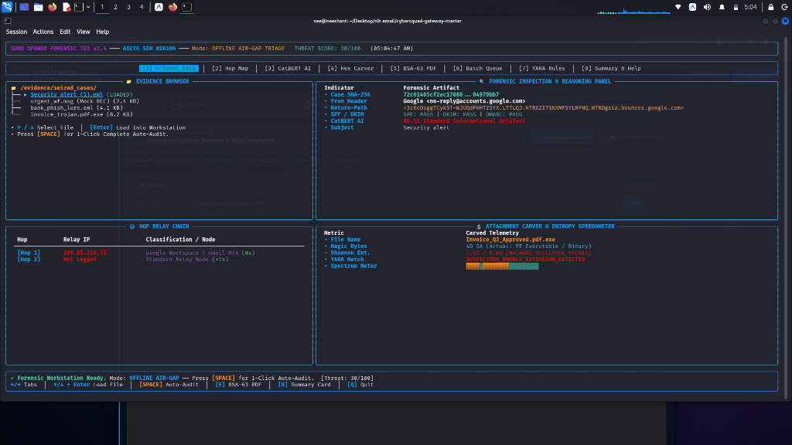
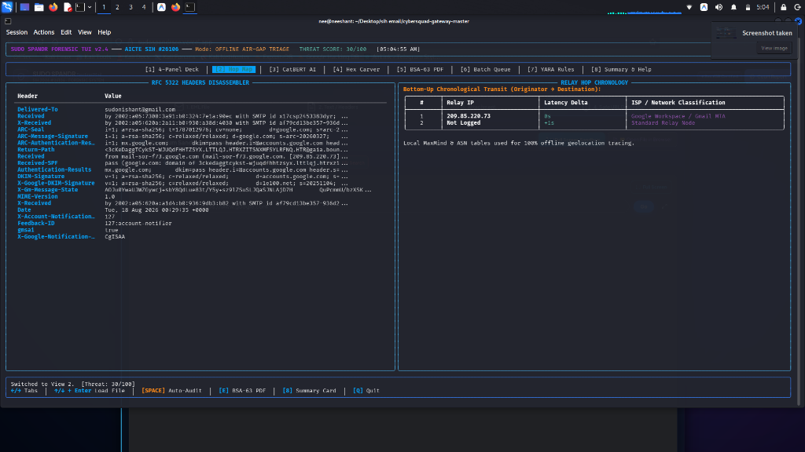
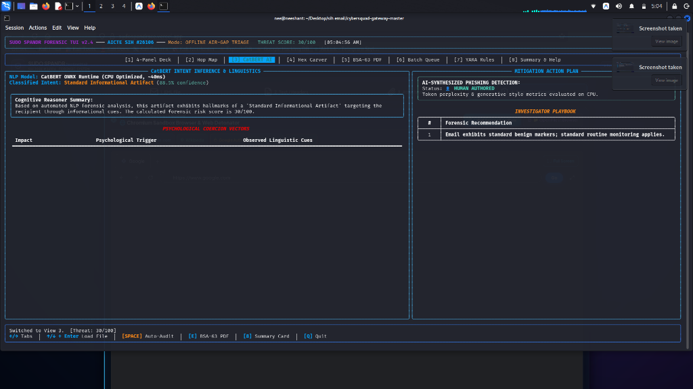
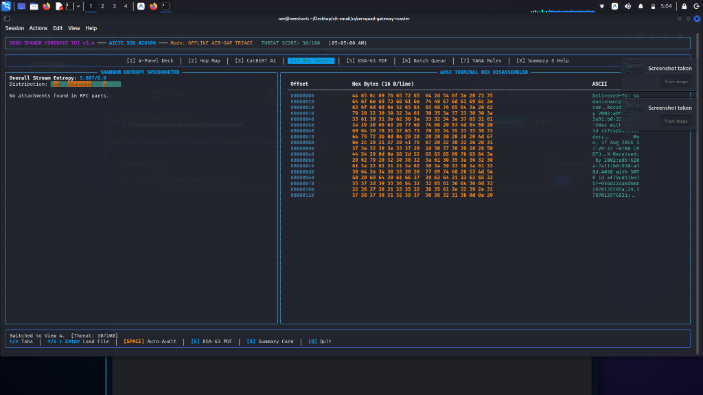

# 🛡️ SUDO SPANDR TUI
### ⚡ 100% Offline Air-Gap Email Forensic Terminal Workstation
**AICTE Smart India Hackathon 2026 | Problem Statement #26106**

<div align="center">

[](https://www.kali.org/)
[]()
[](https://sih.gov.in)
[]()

</div>

---

## 🚀 Live Terminal Demo

<div align="center">
  
</div>

---

## 💡 What is SUDO SPANDR? (In 10 Seconds)

Tired of uploading confidential case evidence to online cloud analyzers? 

**SUDO SPANDR TUI** is a lightweight, super-fast terminal tool that dissects raw `.eml` and `.msg` emails **100% offline** in under **50ms**. No cloud, no data leaks, pure forensic reverse-engineering.

---

## 📋 Complete Step-by-Step Sequence & Options Guide

---

### 🟢 STEP 1: Installation & Quick Setup
Get started in under 1 minute:
```bash
git clone https://github.com/sudonishant/SUDO-SPANDR-TUI.git
cd SUDO-SPANDR-TUI
pip install -r requirements.txt
```

#### ⚙️ Installation Options:
- **Option 1.1 (Recommended)**: Isolated Python virtual environment:
  ```bash
  python3 -m venv .venv && source .venv/bin/activate
  pip install -r requirements.txt
  ```
- **Option 1.2**: System-wide Debian / Kali Linux installation:
  ```bash
  sudo apt update && sudo apt install python3-rich python3-pyqt6
  ```

---

### 🟢 STEP 2: Choose Your Launch Mode
Choose the operational mode that fits your investigation environment:

```bash
# Option 2.1: Launch Terminal TUI (Best for SSH / Headless Servers)
./run_tui.sh

# Option 2.2: Directly Target an Evidence File
python3 app.py "/path/to/evidence.eml"

# Option 2.3: Launch NSA Ghidra-Style Desktop GUI
./run_gui.sh
```

---

### 🟢 STEP 3: CLI Command-Line Options (`-h` / `--help`)
Run automated forensic audits, batch scans, and court exports directly from your terminal:

```bash
python3 app.py --help
```

#### 🛠️ Complete CLI Options Reference Table:

| Flag / Option | Parameter | Purpose / Description | Example Command Line |
|:---|:---|:---|:---|
| **`-h`**, **`--help`** | *None* | Show complete help menu, argument groups & examples | `python3 app.py -h` |
| **`[file]`** | `path/to/mail.eml` | Open target email directly in interactive TUI | `python3 app.py "sample.eml"` |
| **`--ai`** | *None* | Run CatBERT Cognitive AI intent & coercion analysis | `python3 app.py --ai "sample.eml"` |
| **`--cert`** | `path/to/mail.eml` | Generate **Section 63 BSA 2023** Court PDF Certificate | `python3 app.py --cert "sample.eml"` |
| **`--officer`** | `"Name"` | Set Investigating Officer name on court certificate | `--officer "Inspector Sharma"` |
| **`--agency`** | `"Lab"` | Set Forensic Lab / Police Station name | `--agency "Cyber Crime PS"` |
| **`--batch`** | `/dir/path/` | Scan entire directory of seized emails in bulk | `python3 app.py --batch /cases/spool/` |
| **`--export-csv`** | `report.csv` | Export batch triage results to CSV spreadsheet | `--batch /cases/ --export-csv report.csv` |
| **`--export-yara`** | `path/to/mail.eml` | Auto-compile YARA threat hunting rule to stdout/file | `python3 app.py --export-yara mail.eml > rule.yar` |
| **`--export-snort`** | `path/to/mail.eml` | Auto-compile Snort/Suricata IDS network rule | `python3 app.py --export-snort mail.eml > rule.rules` |
| **`--stdin`** | *None* | Ingest raw email stream from Unix pipe (MTA integration) | `cat mail.eml \| python3 app.py --stdin` |

---

### 🟢 STEP 4: In-App Interactive Forensic Navigation (Tabs [1] to [8])
Once inside the TUI, navigate sequentially through the 8 specialized forensic panels:

#### 1. Tab [1] — 4-Panel Master Command Deck


**Options & Controls in Tab 1:**
- `[↑]` / `[↓]`: Browse and select seized emails from your evidence directory.
- `[Enter]`: Ingest and lock selected evidence into the workstation.
- `[SPACE]`: **1-Click Auto-Audit** (Runs full forensic autopsy and populates all indicators).
- Live Indicators: Case SHA-256 bitstream digest, Sender Spoofing check, SPF/DKIM crypto status, and Attachment Entropy speedometer.

---

#### 2. Tab [2] — Hop Relay Map & Header Disassembler


**Options & Controls in Tab 2:**
- Reconstruct the full chronological MTA transit graph ($Hop_1 \rightarrow Hop_n$).
- Check transit latency deltas ($\Delta t = t_{hop_{n+1}} - t_{hop_n}$) to identify forged internal hops.
- Inspect originating IP addresses, Tor exit nodes, and ISP network classifications.

---

#### 3. Tab [3] — CatBERT AI: Intent & Psychological Coercion


**Options & Controls in Tab 3:**
- View offline Cognitive NLP intent classification (runs in ~40ms on CPU).
- Identify psychological coercion triggers (Urgency, Fear, Legal Intimidation, Fake Invoices).
- Review automated Incident Mitigation Playbook steps.

---

#### 4. Tab [4] — Hex Carver & Shannon Entropy Speedometer


**Options & Controls in Tab 4:**
- 16-byte Ghidra/IDA Pro style byte viewer with byte offsets and ASCII disassembly.
- Real-time Shannon Entropy Speedometer ($0.00$ to $8.00$ bits) for detecting packed malware ($H \ge 7.2$).
- True 16-byte magic verification: catches executables disguised with fake extensions (e.g. `Invoice.pdf.exe` $\rightarrow$ `4D 5A` MZ).

---

#### 5. Additional Forensic Panels ([5] to [8])
- **Tab [5] — BSA-63 PDF Certificate**: Preview and export Section 63 BSA 2023 legal certificate.
- **Tab [6] — Batch Triage Queue**: Monitor bulk directory processing and severity rankings.
- **Tab [7] — YARA & Snort Rules**: Auto-compiled threat signatures ready for perimeter firewalls.
- **Tab [8] — Executive Summary**: Plain-language summary designed for police officers and judges.

---

### 🟢 STEP 5: Quick Keyboard Hotkey Cheat Sheet

| Key | Action | What Happens |
|:---:|:---|:---|
| **`[SPACE]`** | **1-Click Auto-Audit** | Runs full autopsy, AI check & generates exports |
| **`[1]` – `[8]`** | Direct Tab Switch | Jump to any forensic panel instantly |
| **`[E]`** | Export BSA-63 PDF | Exports Section 63 BSA 2023 court-admissible certificate |
| **`[F]`** | Police FIR Draft | Generates ready-to-file complaint (IT Act §66D & BNS §318) |
| **`[Y]`** | Export Threat Rules | Saves YARA & Snort rules directly to `./forensic_exports/` |
| **`[Q]`** | Exit Cleanly | Closes the forensic workstation safely |

---

## 📚 Technical Deep Dive & Legal Compliance (Expandable)

<details>
<summary><b>🔍 Click to View: 9-Stage Forensic Post-Mortem Pipeline</b></summary>

<br>

Every email passes through 9 deterministic stages:
1. **Ingestion & Hash Locking**: Computes SHA-256 and MD5 digests in read-only memory.
2. **RFC 5322 Unfolding**: Unfolds multiline CRLF headers without altering raw byte offsets.
3. **Identity Alignment**: Detects domain divergence between `From:` and `Return-Path:`.
4. **Crypto Verification**: Evaluates SPF, DKIM (RSA-SHA256), and DMARC alignment.
5. **Relay Hop Chronology**: Bottom-up topological sorting of `Received:` headers ($\Delta t$ latency math).
6. **True Magic Carver**: Validates initial 16 bytes (`4D 5A` MZ, `7F 45 4C 46` ELF, `25 50 44 46` PDF).
7. **Shannon Entropy Meter**: Calculates bitstream randomness:
   $$H(X) = -\sum_{i=0}^{255} P(x_i) \log_2 P(x_i)$$
   *(Scores $\ge 7.2$ flag packed malware/shellcode).*
8. **Cognitive NLP**: CatBERT neural heuristics score urgency, fear, and executive impersonation.
9. **Legal Output**: Exports court-admissible Section 63 BSA PDF certificate & YARA rules.
</details>

<details>
<summary><b>⚖️ Click to View: Section 63 BSA 2023 Court Admissibility</b></summary>

<br>

Under the **Bharatiya Sakshya Adhiniyam, 2023 (BSA 2023)** (which repealed Section 65B of the Indian Evidence Act, 1872), electronic evidence must be backed by a statutory certificate.

SUDO SPANDR automatically produces court-ready PDFs containing:
- Examiner official credentials & machine telemetry (MAC, OS build).
- Cryptographic SHA-256 / MD5 bitstream immutability chain.
- Statutory declaration under Section 63(4) BSA 2023.
</details>

---

## 👥 Authors & Acknowledgments

- **Team**: SUDO SPANDR ([@sudonishant](https://github.com/sudonishant))
- **Initiative**: AICTE Smart India Hackathon 2026 | Problem Statement #26106
- **License**: MIT

<div align="center">
  <sub>Built for Sovereign Cyber Defense & National Incident Response • 100% Offline Air-Gap Certified</sub>
</div>
